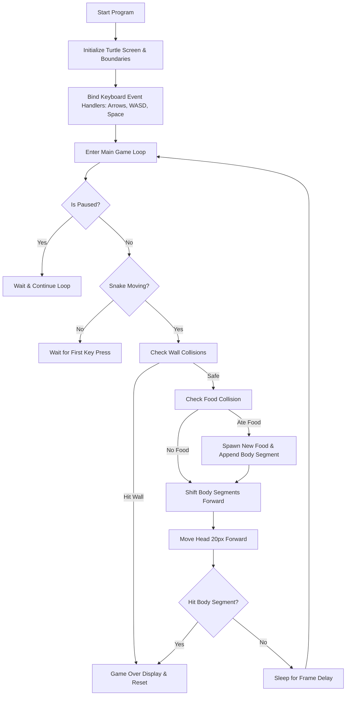

# AGENTS.md - Project Context

**Export Date:** 2026-10-14  
**Project Location:** `C:\Users\angelo\Desktop\Anti-Gravity Course`  
**Python Version:** Python 3.8.10  
**Dependencies:** Standard Library only (`turtle`, `time`, `random`)

---

## 1. Project Overview

This project is a clean, modern, beginner-friendly implementation of the classic **Snake** arcade game written in Python. It requires **no third-party dependencies** (`pip install` is not needed) and runs out-of-the-box on Windows, macOS, and Linux.

### Key Highlights
- **Zero Configuration / No Installs:** Built strictly on Python's built-in `turtle` graphics library.
- **Dual Control Scheme:** Supports Arrow Keys and `W`, `A`, `S`, `D`.
- **Anti-Reverse Input Buffering:** Prevents instantaneous 180-degree self-collisions when pressing directional keys in rapid succession.
- **Pause & Resume:** Built-in `Spacebar` toggle.
- **Scoreboard & High Score:** Tracks both current score and session high score.
- **Safe Food Spawning:** Guarantees food will never spawn inside the snake's body or outside playable borders.
- **Double-Click Launcher:** Includes a `run_game.bat` batch script for launching without opening a command prompt.

---

## 2. File Structure

```text
Anti-Gravity Course/
├── snake.py       # Main Python game script
├── run_game.bat   # Windows 1-click batch launcher
├── README.md      # User documentation & quick-start guide
└── EXPORT.md      # This export document
```

---

## 3. How to Run the Game

### Method A: 1-Click Launch (Recommended)
1. Open the folder: `C:\Users\angelo\Desktop\Anti-Gravity Course`
2. Double-click **`run_game.bat`** (or double-click **`snake.py`**).

### Method B: Terminal / Command Prompt
Open PowerShell or Command Prompt, navigate to the folder, and run:
```powershell
cd "C:\Users\angelo\Desktop\Anti-Gravity Course"
python snake.py
```

---

## 4. Controls Reference

| Action | Primary Key | Alternative Key |
|---|---|---|
| **Move Up** | `↑` (Up Arrow) | `W` / `w` |
| **Move Down** | `↓` (Down Arrow) | `S` / `s` |
| **Move Left** | `←` (Left Arrow) | `A` / `a` |
| **Move Right** | `→` (Right Arrow) | `D` / `d` |
| **Pause / Resume** | `Spacebar` | `Spacebar` |
| **Quit Game** | Close the window (`X`) | Close the window (`X`) |

---

## 5. Complete Source Code

### 5.1 `snake.py`
```python
"""
Classic Snake Game in Python
-----------------------------
Built with Python's standard 'turtle' module.
No third-party packages required — runs out of the box!
"""

import random
import time
import turtle

# ==============================================================================
# GAME CONFIGURATION (Feel free to customize!)
# ==============================================================================
WINDOW_WIDTH = 800
WINDOW_HEIGHT = 600

# Speed settings (Lower delay = faster snake)
# 0.14 is relaxed and beginner-friendly ("Easy")
INITIAL_DELAY = 0.14
MIN_DELAY = 0.06           # Maximum speed cap
SPEED_RAMP = 0.0015        # How much delay decreases per food eaten

# Color Palette (Modern Dark Theme)
COLOR_BG = "#1e1e2e"       # Deep slate navy background
COLOR_BORDER = "#475569"   # Slate gray playing field border
COLOR_HEAD = "#4ade80"     # Bright neon green head
COLOR_BODY = "#22c55e"     # Lush green body
COLOR_FOOD = "#f87171"     # Vibrant apple red
COLOR_TEXT = "#f8fafc"     # Crisp white score text
COLOR_OVER = "#ef4444"     # Red game-over text

# Play Area Boundaries (Grid coordinates)
# The playable area sits inside a 560x500 box
GRID_MIN_X = -13  # -260px
GRID_MAX_X = 13   #  260px
GRID_MIN_Y = -13  # -260px
GRID_MAX_Y = 11   #  220px
# ==============================================================================

# Game State
score = 0
high_score = 0
delay = INITIAL_DELAY
is_paused = False
next_direction = "stop"


# ------------------------------------------------------------------------------
# Screen & Window Setup
# ------------------------------------------------------------------------------
window = turtle.Screen()
window.title("Classic Snake Game")
window.bgcolor(COLOR_BG)
window.setup(width=WINDOW_WIDTH, height=WINDOW_HEIGHT)
window.tracer(0)  # Disable auto-refresh for smooth, flicker-free rendering


# ------------------------------------------------------------------------------
# Draw Play Area Border
# ------------------------------------------------------------------------------
def draw_border():
    border = turtle.Turtle()
    border.speed(0)
    border.color(COLOR_BORDER)
    border.pensize(3)
    border.penup()
    border.hideturtle()

    # Draw rectangular perimeter around the playable grid
    top_y = GRID_MAX_Y * 20 + 15
    bottom_y = GRID_MIN_Y * 20 - 15
    left_x = GRID_MIN_X * 20 - 15
    right_x = GRID_MAX_X * 20 + 15

    border.goto(left_x, top_y)
    border.pendown()
    border.goto(right_x, top_y)
    border.goto(right_x, bottom_y)
    border.goto(left_x, bottom_y)
    border.goto(left_x, top_y)


draw_border()


# ------------------------------------------------------------------------------
# Game Objects: Head, Food, Segments, Pen
# ------------------------------------------------------------------------------
# Snake Head
head = turtle.Turtle()
head.speed(0)
head.shape("square")
head.color(COLOR_HEAD)
head.penup()
head.goto(0, 0)
head.direction = "stop"

# Food
food = turtle.Turtle()
food.speed(0)
food.shape("circle")
food.color(COLOR_FOOD)
food.penup()
food.goto(0, 80)

# Body segments list
segments = []

# Scoreboard Pen
pen = turtle.Turtle()
pen.speed(0)
pen.color(COLOR_TEXT)
pen.penup()
pen.hideturtle()
pen.goto(0, 255)


def update_scoreboard():
    """Redraws the score and high-score header."""
    pen.clear()
    pen.write(
        f"Score: {score}   |   High Score: {high_score}",
        align="center",
        font=("Arial", 16, "bold"),
    )


# ------------------------------------------------------------------------------
# Movement & Controls
# ------------------------------------------------------------------------------
def go_up():
    global next_direction
    if head.direction != "down" and next_direction != "down" and not is_paused:
        next_direction = "up"


def go_down():
    global next_direction
    if head.direction != "up" and next_direction != "up" and not is_paused:
        next_direction = "down"


def go_left():
    global next_direction
    if head.direction != "right" and next_direction != "right" and not is_paused:
        next_direction = "left"


def go_right():
    global next_direction
    if head.direction != "left" and next_direction != "left" and not is_paused:
        next_direction = "right"


def toggle_pause():
    """Pauses or resumes the game."""
    global is_paused
    if head.direction == "stop":
        return  # Don't pause before game starts

    is_paused = not is_paused
    if is_paused:
        pen.goto(0, 0)
        pen.color(COLOR_TEXT)
        pen.write("PAUSED (Press Space)", align="center", font=("Arial", 22, "bold"))
        pen.goto(0, 255)
    else:
        update_scoreboard()


def move():
    """Moves the snake head one step in the active direction."""
    if head.direction == "up":
        head.sety(head.ycor() + 20)
    elif head.direction == "down":
        head.sety(head.ycor() - 20)
    elif head.direction == "left":
        head.setx(head.xcor() - 20)
    elif head.direction == "right":
        head.setx(head.xcor() + 20)


def reposition_food():
    """Places food at a random grid point not occupied by the snake."""
    while True:
        rand_x = random.randint(GRID_MIN_X, GRID_MAX_X) * 20
        rand_y = random.randint(GRID_MIN_Y, GRID_MAX_Y) * 20

        # Verify new spot doesn't clash with snake head or any segment
        clash = (head.xcor() == rand_x and head.ycor() == rand_y) or any(
            seg.xcor() == rand_x and seg.ycor() == rand_y for seg in segments
        )
        if not clash:
            food.goto(rand_x, rand_y)
            break


def trigger_game_over():
    """Displays game over animation and resets the board."""
    global score, delay, next_direction

    # Show Game Over Banner
    pen.goto(0, 0)
    pen.color(COLOR_OVER)
    pen.write("GAME OVER!", align="center", font=("Arial", 26, "bold"))
    window.update()
    time.sleep(0.9)

    # Clean up segments
    for segment in segments:
        segment.goto(2000, 2000)
    segments.clear()

    # Reset position and state
    head.goto(0, 0)
    head.direction = "stop"
    next_direction = "stop"
    score = 0
    delay = INITIAL_DELAY

    # Restore pen & scoreboard
    pen.color(COLOR_TEXT)
    pen.goto(0, 255)
    update_scoreboard()


# ------------------------------------------------------------------------------
# Key Bindings
# ------------------------------------------------------------------------------
window.listen()

# Arrow keys
window.onkeypress(go_up, "Up")
window.onkeypress(go_down, "Down")
window.onkeypress(go_left, "Left")
window.onkeypress(go_right, "Right")

# WASD keys (lowercase and uppercase for CapsLock tolerance)
window.onkeypress(go_up, "w")
window.onkeypress(go_down, "s")
window.onkeypress(go_left, "a")
window.onkeypress(go_right, "d")
window.onkeypress(go_up, "W")
window.onkeypress(go_down, "S")
window.onkeypress(go_left, "A")
window.onkeypress(go_right, "D")

# Spacebar for Pause
window.onkeypress(toggle_pause, "space")


# ------------------------------------------------------------------------------
# Main Game Loop
# ------------------------------------------------------------------------------
def main():
    global score, high_score, delay, next_direction

    update_scoreboard()

    # Display introductory start hint
    pen.goto(0, -30)
    pen.write("Use Arrow Keys or WASD to start", align="center", font=("Arial", 12, "italic"))
    pen.goto(0, 255)

    try:
        while True:
            window.update()

            if is_paused:
                time.sleep(0.05)
                continue

            # Clear start hint once movement begins
            if head.direction == "stop" and next_direction != "stop":
                head.direction = next_direction
                update_scoreboard()
            elif head.direction != "stop":
                head.direction = next_direction

            # Only process gameplay if snake is moving
            if head.direction != "stop":
                # 1. Check Wall Collisions
                limit_x = GRID_MAX_X * 20
                limit_y_top = GRID_MAX_Y * 20
                limit_y_bottom = GRID_MIN_Y * 20

                if (
                    head.xcor() > limit_x
                    or head.xcor() < -limit_x
                    or head.ycor() > limit_y_top
                    or head.ycor() < limit_y_bottom
                ):
                    trigger_game_over()
                    continue

                # 2. Check Food Collision
                if head.distance(food) < 18:
                    reposition_food()

                    # Create & attach new body segment
                    new_segment = turtle.Turtle()
                    new_segment.speed(0)
                    new_segment.shape("square")
                    new_segment.color(COLOR_BODY)
                    new_segment.penup()
                    segments.append(new_segment)

                    # Update scores
                    score += 10
                    if score > high_score:
                        high_score = score
                    update_scoreboard()

                    # Gentle speed increment
                    delay = max(MIN_DELAY, delay - SPEED_RAMP)

                # 3. Move trailing body segments in reverse order
                for i in range(len(segments) - 1, 0, -1):
                    x = segments[i - 1].xcor()
                    y = segments[i - 1].ycor()
                    segments[i].goto(x, y)

                # Move segment 0 to old head location
                if len(segments) > 0:
                    segments[0].goto(head.xcor(), head.ycor())

                # 4. Move head forward
                move()

                # 5. Check Self-Collision
                collision = False
                for segment in segments:
                    if segment.distance(head) < 12:
                        collision = True
                        break

                if collision:
                    trigger_game_over()
                    continue

            time.sleep(delay)

    except (turtle.Terminator, turtle.TK.TclError):
        # Gracefully handle window close without error tracebacks
        pass


if __name__ == "__main__":
    main()
```

---

### 5.2 `run_game.bat`
```bat
@echo off
title Snake Game
cd /d "%~dp0"
python snake.py
pause
```

---

### 5.3 `README.md`
```markdown
# 🐍 Classic Snake Game in Python

A lightweight, beginner-friendly Snake game built entirely with Python's built-in **`turtle`** graphics library.

**No third-party packages or `pip install` required!** It runs directly on standard Python.

---

## 🎮 Features

- **Zero Installations**: Runs instantly using Python's standard library.
- **Dual Controls**: Play using either the **Arrow keys** or **WASD**.
- **Pause & Resume**: Press `Spacebar` anytime to pause.
- **Score & High Score**: Displays current score and retains the session high score.
- **Smooth & Responsive**: Includes input buffering to prevent accidental 180° self-collisions.
- **Clear Boundaries**: Visible arena border with safe random food spawning.
- **Modern Dark Palette**: Easy on the eyes with vibrant neon accents.

---

## 🚀 How to Run

1. Open your terminal or Command Prompt in this folder:
   ```bash
   cd "C:\Users\angelo\Desktop\Anti-Gravity Course"
   ```

2. Run the game:
   ```bash
   python snake.py
   ```

3. Press any movement key (**Arrow Keys** or **WASD**) to start moving!

---

## 🕹️ Controls

| Action | Primary Key | Alternative Key |
|---|---|---|
| **Move Up** | `↑` (Up Arrow) | `W` |
| **Move Down** | `↓` (Down Arrow) | `S` |
| **Move Left** | `←` (Left Arrow) | `A` |
| **Move Right** | `→` (Right Arrow) | `D` |
| **Pause / Resume** | `Spacebar` | `Spacebar` |
| **Exit** | Close the window (`X`) | Close the window (`X`) |

---

## ⚙️ Easy Customization

All game settings are clearly defined at the top of `snake.py`. You can tweak them directly:

### 1. Change Difficulty / Speed
```python
# Initial delay per frame in seconds (lower number = faster snake)
INITIAL_DELAY = 0.14   # 0.16 = Very Easy | 0.12 = Normal | 0.08 = Hard
MIN_DELAY = 0.06       # Maximum speed limit
SPEED_RAMP = 0.0015    # How much speed increases per apple eaten
```

### 2. Customize Colors
```python
COLOR_BG = "#1e1e2e"       # Dark background
COLOR_BORDER = "#475569"   # Arena border
COLOR_HEAD = "#4ade80"     # Snake head
COLOR_BODY = "#22c55e"     # Snake body segments
COLOR_FOOD = "#f87171"     # Food apple
```

### 3. Change Window Size
```python
WINDOW_WIDTH = 800
WINDOW_HEIGHT = 600
```
```

---

## 6. Architecture & Implementation Mechanics



1. **Grid Stepping (`20px`)**: The play area is divided into discrete 20×20 pixel cells, matching the size of a standard turtle square shape.
2. **Body Tracking (Trailing Array)**: The body segments are stored in an array. Each frame, segment `i` takes the position of segment `i - 1`, and the first segment takes the head's previous position.
3. **No-Clash Food Generation**: When food is eaten, random coordinates are generated inside a while loop until a cell is found that is neither the head nor any body segment.
4. **Input Protection**: When turning, both the current direction and buffered target direction are checked so pressing an opposite direction key is safely rejected.

---

## 7. System Diagnostics

- **Operating System:** Windows 10
- **PowerShell Version:** 5.1.19041.3803 Desktop Edition
- **Python Executable:** `C:\Users\angelo\AppData\Local\Programs\Python\Python38\python.exe` (Version 3.8.10)
- **Standard Library Modules Used:** `turtle`, `time`, `random`, `tkinter`
